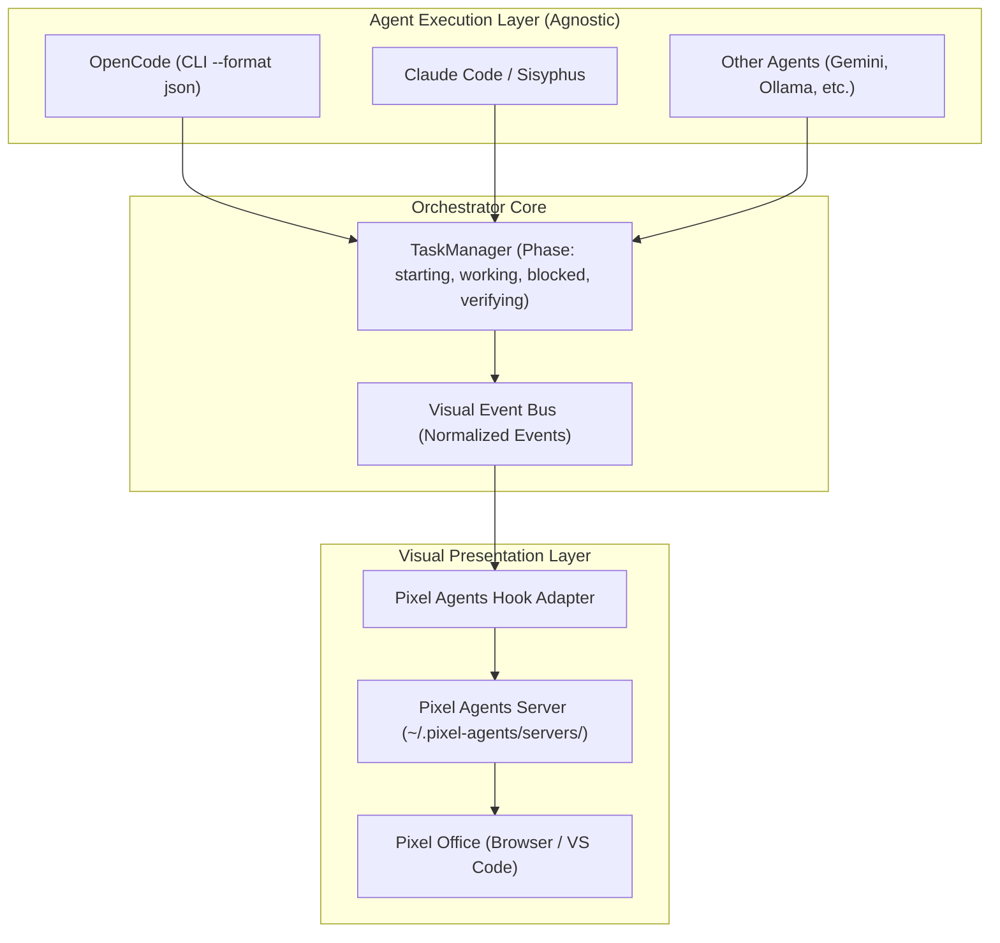

# Pixel Agents + OpenCode Integration Plan (Agent-Agnostic Architecture)

## Goal Description
Integrate [Pixel Agents](https://github.com/pixel-agents-hq/pixel-agents) with `opencode-orchestrator` to visualize autonomous development tasks in a 2D pixel-art virtual office. 

Ensure the integration is **100% agent-agnostic** so that whether tasks are executed by **OpenCode**, **Claude Code**, or other future AI coding engines, the visual office reflects character typing, reading, terminal runs, quality gate testing, and human review pauses seamlessly.

---

## Technical Analysis: How Pixel Agents Works Under the Hood

### 1. Does Pixel Agents work with OpenCode?
**Yes.** 
While Claude Code was the first reference implementation in Pixel Agents, the internal architecture (`pixel-agents-hq/pixel-agents/core`) is built around a decoupled **`HookProvider`** interface and an **`AgentEvent`** protocol.

Pixel Agents runs a local HTTP/WebSocket server (via `npx pixel-agents` or its VS Code extension) and writes server endpoint descriptors to:
```
~/.pixel-agents/servers/<pid>.json
```
Active servers accept standard lifecycle hook payloads:
* `SessionStart`: Spawns/assigns an avatar to a desk with issue metadata.
* `PreToolUse`: Triggers specific pixel animations based on tool type:
  * File editing (`edit_file`, `write_file`) ➔ Avatar types actively on the keyboard.
  * File searching/viewing (`read_file`, `glob`, `grep`) ➔ Avatar reads documents/books.
  * Bash execution (`bash`, `npm test`, `git`) ➔ Avatar monitors a running terminal.
* `PermissionRequest` / `Blocked`: Raises a visual alert flag over the avatar's head.
* `Stop` / `SessionEnd`: Marks the task completed, clears the desk, or transitions to idle.

### 2. Is it Agent-Agnostic?
**Yes.**
`opencode-orchestrator` already intercepts all OpenCode activity in real-time (`src/tasks/opencode.ts` via `--format json`). 
By introducing an **Orchestrator Visual Event Bus**, we normalize events from OpenCode (and any other agent runtime) into generic visual actions:



---

## User Review Required

> [!IMPORTANT]
> **Non-Intrusive Design**: The visual adapter runs asynchronously and fail-safe. If Pixel Agents is not running on your machine, `opencode-orchestrator` continues executing GitHub tasks normally with zero performance degradation or errors.

> [!TIP]
> **Zero Installation Overhead**: You can view your office simply by running:
> ```bash
> npx pixel-agents
> ```
> in any terminal window or by installing the Pixel Agents VS Code extension.

---

## Open Questions

None currently blocking. Configuration will default to `VISUAL_PIXEL_AGENTS=true` with graceful fallback when no server is listening.

---

## Proposed Changes

### Component 1: Event System Abstraction (Agent-Agnostic)

#### [NEW] `src/events/types.ts`
Defines normalized visual event payloads decoupled from any specific LLM provider or UI tool:

```typescript
export type AgentActivityType = 'typing' | 'reading' | 'executing' | 'idle' | 'waiting_approval';

export interface VisualAgentEvent {
    sessionId: string;
    issueNumber: number;
    issueTitle: string;
    branchName?: string;
    activity: AgentActivityType;
    toolName?: string;
    summary?: string;
    timestamp: number;
}
```

#### [NEW] `src/events/bus.ts`
Singleton event emitter dispatching normalized events across the orchestrator.

---

### Component 2: Pixel Agents Adapter

#### [NEW] `src/visual/pixel-agents/client.ts`
- Discovers active Pixel Agents server instances by reading `~/.pixel-agents/servers/*.json`.
- Translates normalized `VisualAgentEvent` objects into Pixel Agents hook payloads (`SessionStart`, `PreToolUse`, `PermissionRequest`, `Stop`).
- Dispatches HTTP POST requests with exponential backoff and silent failure when no servers exist.

#### [NEW] `src/visual/pixel-agents/mapper.ts`
Maps OpenCode tool invocations to Pixel Agents animations:
* `write_file`, `edit_file`, `str_replace` ➔ `typing`
* `read_file`, `list_dir`, `grep`, `find` ➔ `reading`
* `bash`, `exec`, `git`, `test` ➔ `executing`
* Task blocked on human `/approve` ➔ `waiting_approval` (alert flag)

---

### Component 3: Orchestrator Hook Ingestion

#### [MODIFY] `src/tasks/opencode.ts`
In `handleLine(task, line)`:
- When `event.type === 'tool_use'`, emit `PreToolUse` event with mapped activity.
- When `event.type === 'text'`, update speech/status summary.
- When `child.on('close')`, emit `Stop` event.

#### [MODIFY] `src/tasks/manager.ts`
In `startTask()`, `continueBlockedTask()`, and `block()`:
- Emit `SessionStart` when a task begins in a worktree.
- Emit `PermissionRequest` when task enters `blocked` or `planning` review state.
- Emit `QualityGate` activity when entering `verifying` phase.

---

### Component 4: Configuration

#### [MODIFY] `src/config.ts` & `.env.example`
Add optional flags:
```env
# Visual Office Integration (Pixel Agents)
ENABLE_PIXEL_AGENTS=true
```

---

## Verification Plan

### Automated Tests
1. **Unit Test for Event Bus**:
   ```bash
   npm run test (or tsx scripts/test-visual-events.ts)
   ```
   Verify that emitting OpenCode JSON events correctly produces normalized Pixel Agents payloads.
2. **Server Discovery Test**:
   Verify that the adapter discovers mock server descriptors in `~/.pixel-agents/servers/` and handles empty directories gracefully.

### Manual Verification
1. Open a terminal and run:
   ```bash
   npx pixel-agents
   ```
   (This opens the pixel office in your default browser at `http://localhost:3000`).
2. Run the orchestrator in another terminal:
   ```bash
   npm run dev
   ```
3. Trigger a test task via a GitHub issue or debug script.
4. Confirm:
   - Avatar walks to desk upon task pickup.
   - Typing animation triggers when OpenCode edits files.
   - Reading animation triggers when OpenCode scans files.
   - Flag appears when waiting for human approval.
